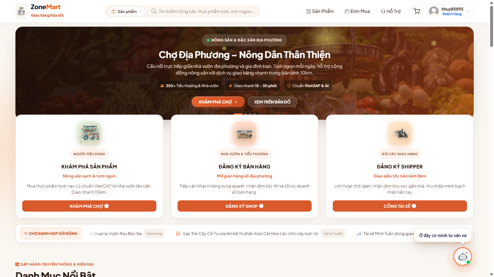
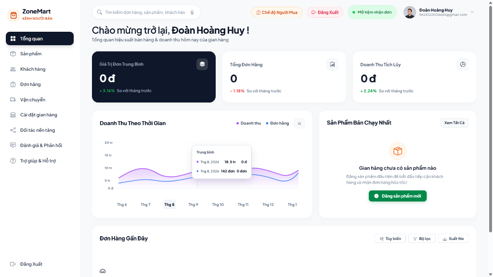
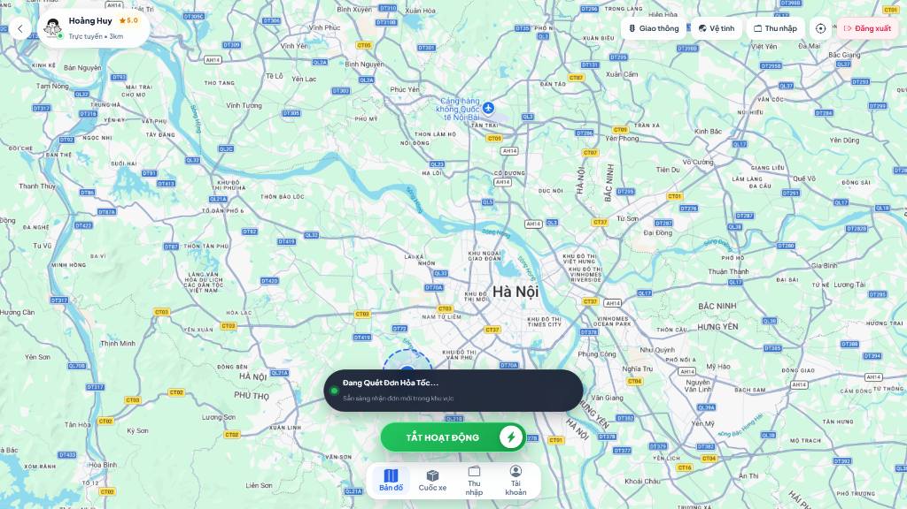
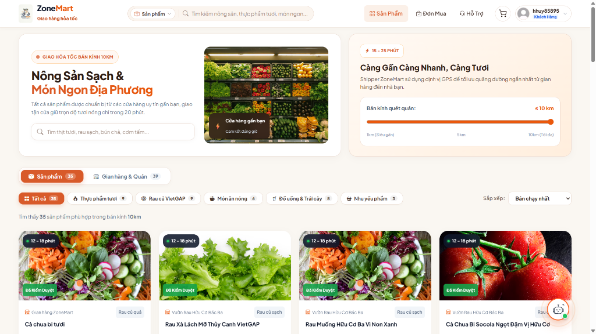
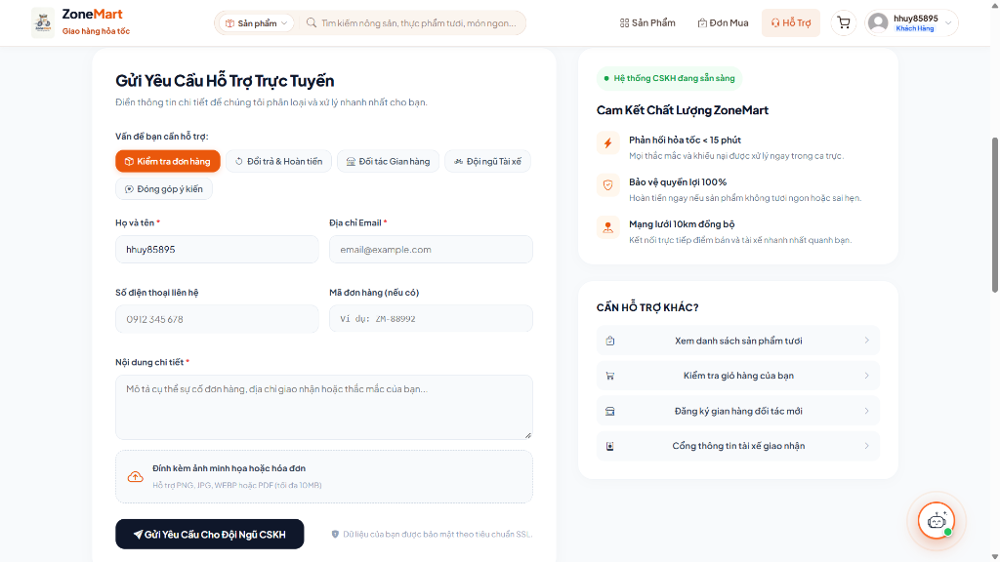
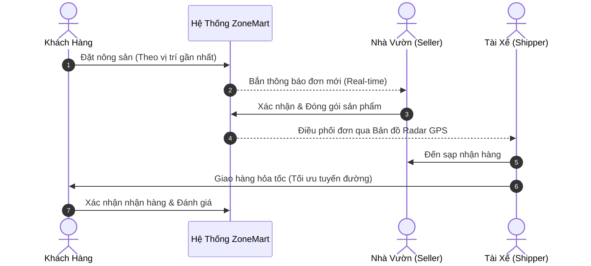

# 🌱 ZoneMart - Nền Tảng Thương Mại Nông Sản & Giao Hàng Hỏa Tốc

<div align="center">

<p align="center">
  
  
  
  
  
</p>

**Cầu nối trực tiếp giữa Nhà vườn địa phương – Người tiêu dùng – Tài xế giao hàng hỏa tốc trong khu vực lân cận.**

</div>

---

## ✨ Trải Nghiệm Giao Diện Tổng Quan

<div align="center">
  
</div>

---

## 🌿 Hệ Sinh Thái Đa Nền Tảng (Multi-Role Ecosystem)

| 🌾 Kênh Nhà Vườn & Tiểu Thương (Merchant Portal) | ⚡ Cổng Điều Phối Tài Xế (Shipper Dispatch) |
| :---: | :---: |
|  |  |
| **Quản trị doanh thu, kho hàng & trạng thái mở tiệm** | **Bản đồ radar GPS nhận đơn hỏa tốc thời gian thực** |

| 🥗 Trải Nghiệm Người Tiêu Dùng (Customer Portal) | 🛡️ Trung Tâm Hỗ Trợ & CSKH (Support Center) |
| :---: | :---: |
|  |  |
| **Tìm kiếm nông sản VietGAP theo cự ly GPS gần nhất** | **Gửi ticket khiếu nại, cam kết phản hồi dưới 15 phút** |

---

## 🗺️ Quy Trình Vận Hành & Điều Phối Đơn Hàng



---

## ⚙️ Kiến Trúc & Ngăn Xếp Công Nghệ (Tech Stack)

| Lớp kiến trúc | Công nghệ & Thư viện sử dụng |
| :--- | :--- |
| **Frontend** | Vue 3 (Composition API), Vite, TypeScript, Pinia, Tailwind CSS |
| **Backend** | ASP.NET Core (.NET 8), Clean Architecture, Entity Framework Core |
| **Bản đồ & Realtime** | OpenStreetMap / Leaflet, SignalR (WebSockets) |
| **Lưu trữ & Cache** | PostgreSQL / SQL Server, Redis Cache |
| **Bảo mật & Vận hành**| Docker Compose, JWT Authentication, RBAC |

---

## 🚀 Hướng Dẫn Khởi Chạy Nhanh (Quick Start)

```bash
# 1. Clone repository
git clone https://github.com/HoangHuy206/ZoneMart.git
cd ZoneMart

# 2. Khởi chạy nhanh toàn bộ hệ thống bằng Docker
docker-compose up -d --build
```
* **Frontend**: `http://localhost:5173`
* **Swagger API**: `http://localhost:5000/swagger`

---

## 👥 Đội Ngũ Phát Triển (Development Team)

Dự án được nghiên cứu, thiết kế và phát triển bởi:

* 👨‍💻 **Đoàn Hoàng Huy**
* 👨‍💻 **Đỗ Văn Bình**
* 👨‍💻 **Lê Đức Thắng**

---

## 📬 Liên Hệ & Bản Quyền

* 📧 **Email hỗ trợ**: [hotrozonemart@gmail.com](mailto:hotrozonemart@gmail.com)
* 🎯 **Mục đích**: Dự án phục vụ nghiên cứu, học tập và xây dựng giải pháp thương mại điện tử nông sản địa phương.
* 🛡️ **Bản quyền**: © 2026 ZoneMart Team. All rights reserved.
